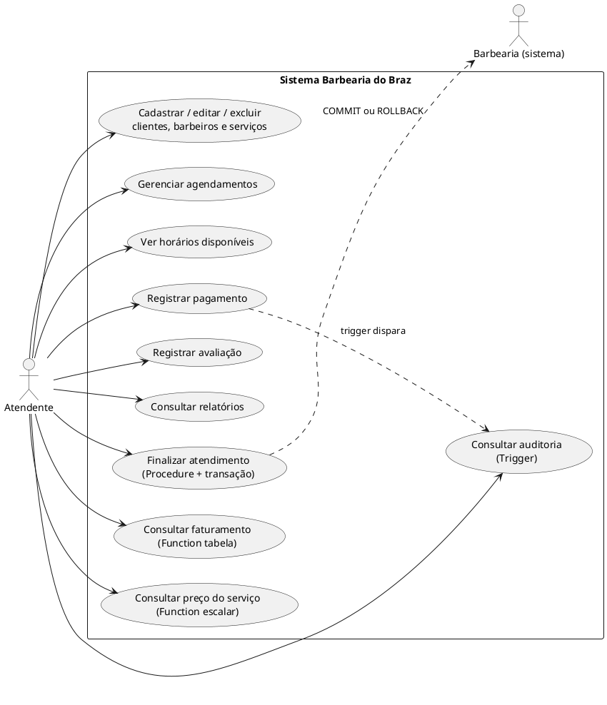

# Diagramas para apresentação

Use estes diagramas no seminário. O texto do PDF permite DER ou diagrama relacional; os dois estão abaixo, em formato textual para poder colar em ferramentas como Mermaid Live Editor ou PlantUML.

---

## 1. Casos de uso (UML — PlantUML)



Frase para falar:

> "O atendente usa as funções antigas de CRUD e relatórios. A novidade é o bloco de objetos do banco: finalizar atendimento, consultar as duas functions e consultar a auditoria gerada pelo trigger."

---

## 2. DER / diagrama relacional (Mermaid)

```mermaid
erDiagram
    CLIENTE ||--o{ AGENDAMENTO : "faz"
    BARBEIRO ||--o{ AGENDAMENTO : "atende"
    SERVICO ||--o{ AGENDAMENTO : "é executado em"
    AGENDAMENTO ||--o| PAGAMENTO : "possui"
    AGENDAMENTO ||--o| AVALIACAO : "recebe"
    CLIENTE ||--o{ AVALIACAO : "avalia"
    BARBEIRO ||--o{ AVALIACAO : "é avaliado"
    PAGAMENTO ||--o{ AUDITORIAPAGAMENTO : "gera auditoria (sem FK)"

    CLIENTE {
        int id_cliente PK
        varchar nome
        varchar telefone UK
        varchar email UK
        date data_cadastro
    }

    BARBEIRO {
        int id_barbeiro PK
        varchar nome
        varchar telefone UK
        varchar email UK
        varchar especialidade
        date data_contratacao
    }

    SERVICO {
        int id_servico PK
        varchar nome UK
        varchar descricao
        numeric preco
        int duracao_minutos
    }

    AGENDAMENTO {
        int id_agendamento PK
        int id_cliente FK
        int id_barbeiro FK
        int id_servico FK
        timestamp data_hora
        varchar status
        varchar observacoes
    }

    PAGAMENTO {
        int id_pagamento PK
        int id_agendamento FK_UK
        numeric valor
        date data_pagamento
        varchar forma_pagamento
        varchar status_pagamento
    }

    AVALIACAO {
        int id_avaliacao PK
        int id_agendamento FK_UK
        int id_cliente FK
        int id_barbeiro FK
        int nota
        varchar comentario
        date data_avaliacao
    }

    AUDITORIAPAGAMENTO {
        int id_auditoria PK
        int id_pagamento
        varchar status_anterior
        varchar status_novo
        timestamp registrado_em
    }
```

Frase para falar:

> "As seis tabelas antigas continuam iguais. A única tabela nova é `AuditoriaPagamento`, criada para o trigger de auditoria. Um agendamento tem no máximo um pagamento e no máximo uma avaliação. O relacionamento com auditoria não é chave estrangeira porque o histórico precisa permanecer mesmo se o pagamento for excluído."

---

## 3. Fluxo da transação (sequência)

```text
Java (CallableStatement)
        │  CALL finalizar_atendimento(id, forma, ?, ?)
        ▼
Procedure
        ├─ SELECT ... FOR UPDATE          (trava a linha)
        ├─ valida status e forma
        ├─ fn_preco_servico(id)           (function escalar)
        ├─ UPDATE Agendamento → REALIZADO
        ├─ se já há pagamento → ROLLBACK  (desfaz o UPDATE)
        ├─ INSERT Pagamento → PAGO
        │        └─ trg_auditoria_pagamento grava auditoria
        └─ COMMIT + OUT 'OK'
```

Frase para falar:

> "O Java apenas chama a procedure. Toda a decisão de commit ou rollback está no banco, então qualquer outro cliente que usar o mesmo banco segue a mesma regra."
